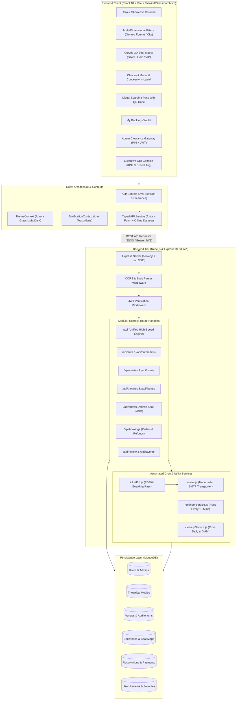
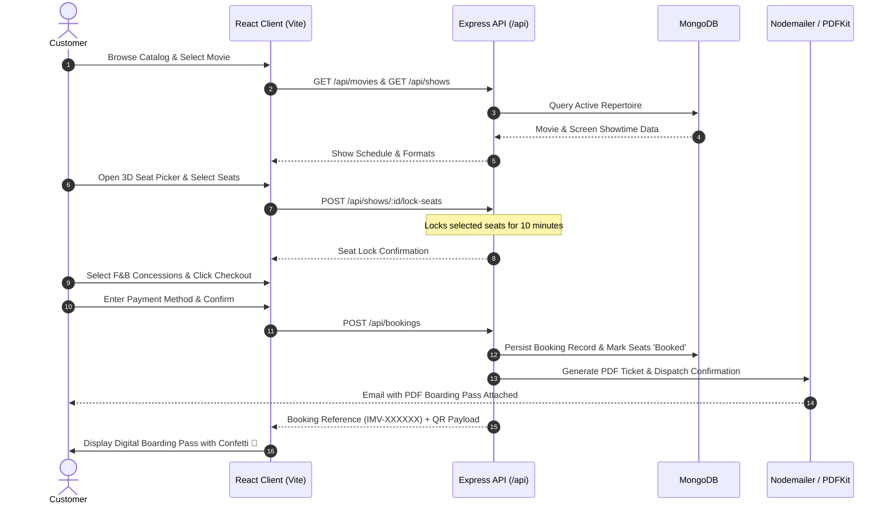

# 🎬 IMovies — Cinema Management & Multiplex Ticketing Engine

[](https://react.dev/)
[](https://www.typescriptlang.org/)
[](https://nodejs.org/)
[](https://expressjs.com/)
[](https://www.mongodb.com/)
[](https://vitejs.dev/)
[](https://jwt.io/)
[](https://tailwindcss.com/)
[](https://opensource.org/licenses/ISC)

> **A modern, full-stack multiplex cinema ticketing and theatre management platform** built with React, Vite, Express, and MongoDB. Featuring real-time interactive 3D seat locking, F&B concessions upselling, digital boarding passes with QR codes, automated PDF tickets via email, background reminder cron jobs, and a protected Executive Administration Console.

---

## 📑 Table of Contents

- [Key Features](#-key-features)
  - [Customer Ticketing Experience](#-customer-ticketing-experience)
  - [Executive Administration Portal](#-executive-administration-portal)
- [System Architecture](#-system-architecture)
  - [High-Level Architecture Diagram](#high-level-architecture-diagram)
  - [Booking & Administration Flowchart](#booking--administration-flowchart)
- [Tech Stack](#-tech-stack)
- [Project Directory Structure](#-project-directory-structure)
- [Database Models & Schemas](#-database-models--schemas)
- [Getting Started](#-getting-started)
  - [Prerequisites](#prerequisites)
  - [Repository Setup](#1-clone-repository)
  - [Backend Setup (`server`)](#2-backend-setup-server)
  - [Frontend Setup (`client`)](#3-frontend-setup-client)
- [Demo Credentials](#-demo-credentials)
- [API Reference](#-api-reference)
  - [Authentication (`/api/auth`)](#authentication-apiauth)
  - [Movies (`/api/movies` & `/api/movie`)](#movies-apimovies--apimovie)
  - [Theatres (`/api/theatres` & `/api/theatre`)](#theatres-apitheatres--apitheatre)
  - [Shows & Seat Matrix (`/api/shows`)](#shows--seat-matrix-apishows)
  - [Bookings & Concessions (`/api/bookings`)](#bookings--concessions-apibookings)
- [Automated Background Services](#-automated-background-services)
- [Design Aesthetics & Glassmorphism](#-design-aesthetics--glassmorphism)
- [License](#-license)

---

## 📌 Key Features

### 👤 Customer Ticketing Experience
- **Cinematic Discovery:** Explore Now Showing & Upcoming theatrical releases complete with high-resolution poster art, trailers, synopses, censor ratings (`PG-13`, `R`), runtimes, directors, and star cast.
- **Multi-Dimensional Filters:** Instant filtering across genres (*Action, Sci-Fi, Drama, Mystery, Thriller, Animation*), projection formats (*IMAX 3D, Dolby Atmos, 4DX, 2D, 70mm*), and regional cities (*New York, Los Angeles, Chicago*).
- **Showtime & Multiplex Selector:** Real-time lookup across city auditoriums with timing slots and screen classifications.
- **Interactive Curved 3D Seat Grid:** Perspective theatre view featuring tier differentiation:
  - 🥈 **Silver Tier ($14)** — Standard digital sightlines
  - 🥇 **Gold Tier ($18)** — Premium central acoustic seats
  - 👑 **VIP Luxury Recliners ($24)** — Front-row plush seating
- **Atomic 10-Minute Seat Locking:** Server-managed seat leases preventing race conditions and double-booking during checkout.
- **Concessions & F&B Upselling:** Integrated snack bar selection (Gourmet Truffle Popcorn, Artisanal Sodas, Nacho Grande Platter, Cinema Combo Packs) with real-time subtotal updates.
- **Instant Checkout & Order Confirmation:** Complete breakdown of seat subtotals, concession costs, convenience fees, and tax.
- **Digital Boarding Pass & QR Pass:** High-fidelity boarding pass featuring alphanumeric reference codes (`IMV-XXXXXX`), auditorium badge, seat tags, and scannable QR verification code.
- **Automated PDF Ticket Delivery:** Instant generation of PDF tickets via `PDFKit` with automated email delivery via `Nodemailer`.
- **My Bookings Wallet:** Track active and past reservations, with one-click cancellation and automated refund handling.

### 🛡️ Executive Administration Portal
- **Security Clearance Gateway:** Dedicated executive gateway guarded by JWT authentication and a Master Security Clearance PIN (`7788` / `9922`).
- **Real-Time KPI Dashboard:**
  - Total box-office revenue velocity and occupancy rates.
  - Active show counts and booking volumes.
  - Day-by-day revenue analytics chart powered by Chart.js.
- **Movie Catalog Management (CRUD):** Add new titles, update runtimes/genres/posters, and toggle Now Showing vs. Upcoming releases.
- **Auditorium Showtime Scheduler:** Schedule screenings across screens, allocate time slots, and configure tier-based ticket pricing.
- **Live Bookings Ledger:** Real-time searchable log of all customer transactions, ticket holders, and payment methods.
- **One-Click Console Lock:** Instantly secure the administrative terminal and return to standard customer view.

---

## 🏗️ System Architecture

### High-Level Architecture Diagram



---

### Booking & Administration Flowchart



---

## 💻 Tech Stack

### Frontend (`client/`)
| Technology | Version / Purpose |
|---|---|
| **React** | `v18.2.0` — Declarative component UI library |
| **Vite** | `v5.0.8` — Ultra-fast frontend build tool and dev server |
| **TypeScript / JSX** | Strongly typed interfaces, state management, and component architecture |
| **Tailwind CSS & SCSS** | Fluid glassmorphism styling, ambient aurora glows, and responsive layout |
| **Lucide React & FontAwesome**| Modern vector icons for UI navigation and status indicators |
| **Framer Motion** | Micro-interactions, spring transitions, and interactive view swaps |
| **Canvas Confetti** | Celebration visual effects on ticket purchase |
| **Chart.js & React-Chartjs-2**| KPI analytics dashboards and day-by-day revenue velocity charts |
| **Axios** | Typed HTTP client for API interactions |

### Backend (`server/`)
| Technology | Version / Purpose |
|---|---|
| **Node.js** | Modern asynchronous runtime environment (v18+ recommended) |
| **Express.js** | `v4.18.2` — REST API routing, controllers, and middleware |
| **MongoDB & Mongoose** | `v8.1.1` — Document database with schemas, validations, and query engine |
| **JWT (`jsonwebtoken`)** | `v9.0.2` — Stateless role-based authentication (`user` vs `admin`) |
| **Bcrypt** | `v5.1.1` — Secure salt-and-hash password encryption |
| **Nodemailer** | `v6.10.1` — SMTP email delivery for ticket confirmations & reminders |
| **PDFKit** | `v0.15.2` — Dynamic server-side cinema boarding pass generation |
| **Node-Cron** | `v4.2.1` — Scheduled background tasks (10-min reminders & daily cleanup) |
| **Stripe** | Payment gateway SDK integration ready |

---

## 📁 Project Directory Structure

```
Movie Ticket Booking System/
├── client/                              # Frontend SPA (React + Vite)
│   ├── public/                          # Static assets and favicons
│   ├── src/                             # Source code
│   │   ├── assets/                      # Curated movie posters and banners
│   │   ├── components/                  # React UI components
│   │   │   ├── AdminDashboard.tsx       # Executive analytics & management console
│   │   │   ├── AdminLoginGateway.tsx    # Security clearance portal (PIN + password)
│   │   │   ├── AuthModal.tsx            # Customer sign-in & registration dialog
│   │   │   ├── CheckoutModal.tsx        # F&B snacks upsell, tax & order confirmation
│   │   │   ├── DigitalTicketPass.tsx    # QR digital boarding pass card
│   │   │   ├── HeroBanner.tsx           # Featured premiere showcase & quick search
│   │   │   ├── MovieCard.tsx            # Film poster card with format badges
│   │   │   ├── MovieFilters.tsx         # Segmented genre, format & status filters
│   │   │   ├── MyBookingsView.tsx       # Customer ticket wallet & cancellations
│   │   │   ├── Navbar.tsx               # Top glassmorphic bar with theme toggle
│   │   │   ├── SeatSelectionView.tsx    # Curved 3D auditorium seat matrix
│   │   │   ├── ShowtimeSelectorModal.tsx# Multiplex timing & screen picker
│   │   │   └── TheatresView.tsx         # City multiplex directory & screen specs
│   │   ├── context/                     # Shared application context
│   │   │   ├── AuthContext.tsx          # JWT session & clearance state
│   │   │   ├── NotificationContext.tsx  # Global toast notifications
│   │   │   └── ThemeContext.tsx         # Light / Dark aurora glass theme
│   │   ├── services/
│   │   │   └── api.ts                   # Typed API service with offline fallback
│   │   ├── types/
│   │   │   └── index.ts                 # TypeScript domain interfaces
│   │   ├── App.tsx                      # Main view orchestrator & aurora canvas
│   │   ├── index.css                    # Design system tokens & glass utility classes
│   │   ├── main.jsx                     # Application bootstrap
│   │   └── reference-ui.css             # Glassmorphic component styles
│   ├── .env                             # Frontend environment configuration
│   ├── index.html                       # HTML5 entry with Outfit & Space Mono fonts
│   ├── package.json                     # Client dependencies & scripts
│   └── vite.config.js                   # Vite configuration
│
├── server/                              # Backend REST API (Node.js + Express)
│   ├── controllers/                     # Core business logic controllers
│   ├── middlewares/                     # JWT authentication & role authorization
│   ├── models/                          # Mongoose schemas & data models
│   │   ├── adminModel.js                # Administrator credentials schema
│   │   ├── bookingModel.js              # Reservation & ticket records
│   │   ├── favoriteModel.js             # User saved favorites
│   │   ├── movieModel.js                # Theatrical movie metadata & formats
│   │   ├── reviewModel.js               # User reviews and star ratings
│   │   ├── showModel.js                 # Auditoriums, timings & seat availability
│   │   ├── theatreModel.js              # Venues, screens, and seating capacities
│   │   └── userModel.js                 # User profile & encrypted password
│   ├── routes/                          # Express API route declarations
│   │   ├── adminRoutes.js               # Admin authentication endpoints
│   │   ├── authRoutes.js                # Customer login and registration
│   │   ├── bookingRoutes.js             # Booking transactions & user history
│   │   ├── favoriteRoutes.js            # User favorites CRUD
│   │   ├── modernApiRoutes.js           # Unified high-speed API engine (UI_REFF)
│   │   ├── movieRoutes.js               # Film repertoire endpoints
│   │   ├── reviewRoutes.js              # Ratings & reviews endpoints
│   │   ├── showRoutes.js                # Showtimes & seat matrix endpoints
│   │   └── theatreRoutes.js             # Venues & city multiplexes
│   ├── utils/                           # Automated background services
│   │   ├── cleanupService.js            # Daily 3 AM expired booking cleanup
│   │   ├── mailer.js                    # Nodemailer transporter verification
│   │   ├── reminderService.js           # 10-minute automated email reminder cron
│   │   └── ticketPdf.js                 # PDFKit cinema boarding pass generator
│   ├── .env                             # Server configuration (DB, JWT, SMTP)
│   ├── .env.example                     # Environment template file
│   ├── package.json                     # Server dependencies & scripts
│   └── server.js                        # Express application entrypoint
│
├── .gitignore                           # Git ignore rules
└── readme.md                            # Comprehensive project documentation
```

---

## 🗄️ Database Models & Schemas

The application is backed by normalized Mongoose models in MongoDB:

```
┌──────────────────┐        ┌──────────────────┐        ┌──────────────────┐
│      Users       │        │     Theatres     │        │      Movies      │
├──────────────────┤        ├──────────────────┤        ├──────────────────┤
│ _id / id         │        │ _id / id         │        │ _id / id         │
│ name             │        │ name             │        │ title            │
│ email (unique)   │        │ city             │        │ genre[]          │
│ password (hash)  │        │ address          │        │ formats[]        │
│ phone            │        │ screens[]        │        │ duration         │
│ role (user/admin)│        └────────┬─────────┘        │ rating           │
└────────┬─────────┘                 │                  │ isNowShowing     │
         │                           │                  └────────┬─────────┘
         │                           ▼                           │
         │                  ┌──────────────────┐                 │
         │                  │      Shows       │                 │
         │                  ├──────────────────┤                 │
         │                  │ _id / id         │                 │
         │                  │ movieId ─────────┼─────────────────┘
         │                  │ theatreId ───────┘
         │                  │ showDate         │
         │                  │ startTime        │
         │                  │ pricing (tiers)  │
         │                  │ seats[] (matrix) │
         │                  └────────┬─────────┘
         │                           │
         ▼                           ▼
┌──────────────────────────────────────┐
│               Bookings               │
├──────────────────────────────────────┤
│ _id / id                             │
│ bookingReference (e.g. IMV-7K9A2X)   │
│ userId / userEmail                   │
│ showId                               │
│ seats[] (row, number, tier, price)   │
│ snacks[] (item, qty, price)          │
│ ticketSubtotal, fee, tax, total      │
│ paymentMethod / paymentId            │
│ bookingStatus (confirmed/cancelled)  │
│ qrCodeData                           │
│ bookedAt                             │
└──────────────────────────────────────┘
```

1. **User (`userModel.js`)**: Name, unique email, bcrypt password hash, phone number, and access role.
2. **Movie (`movieModel.js`)**: Title, tagline, description, duration, genre array, certificate rating, formats (`IMAX 3D`, `Dolby`, `2D`), director, cast, trailer URL, and poster URL.
3. **Theatre (`theatreModel.js`)**: Venue name, city, location address, total screens, and screen definitions (screen number, name, seating capacity, audio/visual type).
4. **Show (`showModel.js`)**: Link between Movie and Theatre, screening date, start time, end time, screen number, tier pricing (Silver, Gold, VIP), and real-time seat matrices.
5. **Booking (`bookingModel.js`)**: Unique alphanumeric booking reference, user references, seat allocations, snack orders, taxes, convenience fees, payment status, and verification QR code.
6. **Review (`reviewModel.js`)**: User film reviews, numerical ratings (1-10), and timestamps.
7. **Favorite (`favoriteModel.js`)**: User bookmarks for fast discovery and reminders.

---

## 🚀 Getting Started

### Prerequisites
Make sure you have installed on your local machine:
- **Node.js**: v18.0.0 or higher ([Download Node.js](https://nodejs.org/))
- **MongoDB**: Local MongoDB community server running on port `27017` or a [MongoDB Atlas](https://www.mongodb.com/cloud/atlas) connection URI
- **Git**: Distributed version control

---

### 1. Clone Repository
```bash
git clone https://github.com/aryan-rn-black/demo_iMovies.git
cd "Movie Ticket Booking System"
```

---

### 2. Backend Setup (`server`)

1. Open a terminal and navigate to `server/`:
   ```bash
   cd server
   ```

2. Install dependencies:
   ```bash
   npm install
   ```

3. Create your `.env` configuration (a template is available in `.env.example`):
   ```env
   # MongoDB Connection URI
   MONGODB_CONNECTION_LINK=mongodb://localhost:27017/movie_booking

   # JWT Secret Key for token signing
   JWT_SECRET=your_jwt_secret_key_here

   # Email Service (Nodemailer SMTP Configuration)
   SMTP_HOST=smtp.gmail.com
   SMTP_PORT=587
   SMTP_USER=your_email@gmail.com
   SMTP_PASS=your_gmail_app_password
   MAIL_FROM="IMovies Box Office" <your_email@gmail.com>

   # Server Port
   PORT=3000
   ```

4. Start the backend server:
   ```bash
   npm run dev    # With nodemon auto-restart
   # or
   npm start      # Standard node execution
   ```
   *The backend REST API will run on `http://localhost:3000`.*

---

### 3. Frontend Setup (`client`)

1. Open a second terminal and navigate to `client/`:
   ```bash
   cd client
   ```

2. Install dependencies:
   ```bash
   npm install
   ```

3. Verify or update the environment configuration (`.env`):
   ```env
   VITE_BACKEND_URL=http://localhost:3000
   ```

4. Start the Vite development server:
   ```bash
   npm run dev
   ```
   *The client interface will launch on `http://localhost:5173`.*

---

## 🔑 Demo Credentials

The platform includes pre-configured demo credentials for testing and evaluation:

| Role | Email | Password | Security PIN | Access Privileges |
| :--- | :--- | :--- | :--- | :--- |
| **Executive Administrator** | `admin@imovies.cinema` | `Admin@123` | `7788` | Full Executive Console, Revenue KPIs, Show Scheduling, Catalog CRUD |
| **Operations Admin (Alt)** | `admin@imovies.com` | `password` | `9922` | Operations Dashboard & Booking Ledger Access |
| **Standard Customer** | `alex@cinephile.com` | `User@123` | — | Movie Browsing, 3D Seat Selection, Checkout, Digital Ticket Wallet |
| **Standard Customer (Alt)** | `sarah@cinema.com` | `password` | — | Customer Ticket Booking & Reviews |

> ⚡ **Quick Access:** The Admin Gateway includes a **⚡ Autofill Credentials** button for instant evaluation without typing!

---

## 📡 API Reference

### Authentication (`/api/auth`)
| Method | Endpoint | Description | Auth Required |
|---|---|---|---|
| `POST` | `/api/auth/register` | Register new customer account | No |
| `POST` | `/api/auth/login` | Sign in with email & password | No |
| `POST` | `/api/auth/admin-login` | Verify executive credentials & Master PIN | No |
| `GET` | `/api/auth/me` | Retrieve authenticated profile | Bearer Token |
| `GET` | `/api/auth/demo-accounts`| Get preset demo account details | No |

### Movies (`/api/movies` & `/api/movie`)
| Method | Endpoint | Description | Auth Required |
|---|---|---|---|
| `GET` | `/api/movies` | List movies with genre, format, status & search filters | No |
| `GET` | `/api/movies/:id` | Fetch specific movie details and upcoming showtimes | No |
| `POST` | `/api/movies` | Add a new theatrical release | Admin |
| `PUT` | `/api/movies/:id` | Update movie metadata, runtimes, formats, or posters | Admin |
| `DELETE`| `/api/movies/:id` | Decommission / remove movie from repertoire | Admin |

### Theatres (`/api/theatres` & `/api/theatre`)
| Method | Endpoint | Description | Auth Required |
|---|---|---|---|
| `GET` | `/api/theatres` | Fetch multiplex venues filtered by regional city | No |
| `POST` | `/api/theatres` | Add a new multiplex venue with auditorium screen specs | Admin |

### Shows & Seat Matrix (`/api/shows`)
| Method | Endpoint | Description | Auth Required |
|---|---|---|---|
| `GET` | `/api/shows` | Retrieve shows filtered by `movieId`, `theatreId`, `date`, `city` | No |
| `GET` | `/api/shows/:id` | Retrieve show details and full real-time seat matrix | No |
| `POST` | `/api/shows` | Schedule a new screening with date, times & tier pricing | Admin |
| `POST` | `/api/shows/:id/lock-seats` | Hold seats temporarily (10-minute atomic lock) | Optional |
| `POST` | `/api/shows/:id/unlock-seats`| Release held seats back to availability pool | Optional |

### Bookings & Concessions (`/api/bookings`)
| Method | Endpoint | Description | Auth Required |
|---|---|---|---|
| `GET` | `/api/bookings` | Retrieve confirmed bookings for customer wallet | Optional |
| `POST` | `/api/bookings` | Finalize ticket purchase, lock seats, and generate QR pass | Optional |
| `POST` | `/api/bookings/:id/cancel`| Cancel reservation, release seats, and trigger refund | Optional |
| `GET` | `/api/bookings/admin/all` | Searchable master bookings ledger | Admin |
| `GET` | `/api/bookings/admin/stats`| Live box-office revenue, occupancy %, and daily velocity | Admin |

---

## ⚙️ Automated Background Services

The server features built-in automated background workers:

1. **Ticket PDF Generation (`utils/ticketPdf.js`):**
   - Renders cinema boarding passes using `PDFKit` with high-resolution layout, booking references, auditorium details, and seat numbers.
2. **Email Dispatcher (`utils/mailer.js`):**
   - Verifies SMTP transport on server boot and delivers order confirmations with attached PDF passes.
3. **Showtime Reminder Service (`utils/reminderService.js`):**
   - Scheduled via `node-cron` to execute **every 10 minutes** (`*/10 * * * *`), emailing customers whose show starts within the upcoming window.
4. **Automated Daily Cleanup (`utils/cleanupService.js`):**
   - Scheduled via `node-cron` to execute **daily at 3:00 AM** (`0 3 * * *`) to purge outdated unconfirmed reservations and optimize database indices.

---

## 🎨 Design Aesthetics & Glassmorphism

The frontend uses a custom-crafted **Aurora Glassmorphism** design system:
- **Specular Ambient Glows:** Multi-layered CSS radial orbs in electric purple, vibrant magenta-pink, and sunburst gold.
- **Glass Panels (`glass-panel-elevated`):** High backdrop-blur filters (`backdrop-blur-xl`) with subtle frosted borders and specular top highlight lines.
- **Typography:** Modern pairing of **Outfit** (primary heading/display font), **Plus Jakarta Sans** (clean body text), and **Space Mono** (timestamps, seat codes, and booking references).
- **Adaptive Light/Dark Theme:** Real-time theme toggle maintaining contrast ratios and glowing accents in both modes.

---

